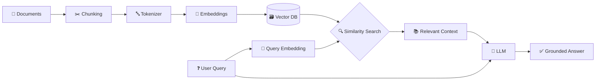

<!-- ===================== HEADER ===================== -->
<p align="center">
  
</p>

<p align="center">
  <a href="https://git.io/typing-svg">
    
  </a>
</p>

<p align="center">
  I build web applications using <b>React.js, Node.js, Express.js, MySQL</b> and <b>Generative AI APIs</b>.
  <br/>
  Passionate about solving problems and building practical, real-world projects.
</p>

<p align="center">
  <a href="https://github.com/ShubhamKumar-25">
    
  </a>
  <a href="https://github.com/ShubhamKumar-25?tab=followers">
    
  </a>
  <a href="https://github.com/ShubhamKumar-25?tab=repositories">
    
  </a>
</p>

---

## 👨‍💻 About Me

```js
const shubham = {
  role: "Full Stack Developer & GenAI Enthusiast",
  education: "B.Tech Information Technology (2027)",
  focus: ["Full Stack Web Development", "Backend Engineering", "Generative AI"],
  currentlyBuilding: "LLM-powered web applications",
  practicing: "Data Structures & Algorithms",
  goal: "Build useful, scalable, real-world applications 🚀",
};
```

- 🎓 B.Tech Information Technology student, graduating in **2027**
- 💻 Focused on **Full Stack Web Development** and **Backend Engineering**
- 🤖 Learned **Generative AI** — LLMs, RAG, Embeddings, Fine-tuning & more
- 🗄️ Working with **REST APIs, authentication** and **relational databases**
- 🧩 Practicing **Data Structures and Algorithms**
- 🌱 Always learning, building and improving one project at a time

---

## 🛠️ Tech Stack

### 👨‍💻 Languages
<p>
  
</p>

### 🎨 Frontend
<p>
  
</p>

### ⚙️ Backend & Database
<p>
  
</p>

### 🧰 Tools & Platforms
<p>
  
</p>

---

## 🧠 Generative AI Skills

> From understanding how models work internally to building production-style AI apps.

### 🔬 Core Concepts

<p>
  
  
  
  
  
  
</p>

### 🧪 Applied GenAI

<p>
  
  
  
  
  
  
</p>

### 🧩 AI Tools & APIs

<p>
  
  
  
</p>

### 🔄 How a RAG Pipeline Works



---

## 🚀 Featured Projects

<table>
  <tr>
    <td width="50%" valign="top">
      <h3>💰 AI Expense Tracker</h3>
      An expense-tracking application with AI-powered features and a relational database.
      <br/><br/>
      
      
      
      
    </td>
    <td width="50%" valign="top">
      <h3>🤖 AI Chatbot</h3>
      A chatbot project built with backend APIs, authentication, and database integration.
      <br/><br/>
      
      
      
      
    </td>
  </tr>
  <tr>
    <td width="50%" valign="top">
      <h3>📄 AI Resume Analyzer</h3>
      An AI-powered application designed to analyze resumes and provide useful feedback.
      <br/><br/>
      
      
      
      
      
    </td>
    <td width="50%" valign="top">
      <h3>👥 Student Management System</h3>
      A backend project for managing student-related information through application APIs.
      <br/><br/>
      
      
      
    </td>
  </tr>
</table>

<p align="center">
  <a href="https://github.com/ShubhamKumar-25?tab=repositories">
    
  </a>
</p>

---

## 📊 GitHub Statistics

> Live stats auto-generated from my GitHub activity.

### 🏆 Overall Stats & Most Used Languages

<table align="center">
  <tr>
    <td align="center"><b>📈 GitHub Stats</b><br/><sub>Total stars, commits, PRs, issues & contributions</sub></td>
    <td align="center"><b>💻 Most Used Languages</b><br/><sub>Languages I use most across my public repositories</sub></td>
  </tr>
  <tr>
    <td>
      
    </td>
    <td>
      
    </td>
  </tr>
</table>

### 🔥 Contribution Streak

<p align="center">
  <sub>Current streak, longest streak and total contributions</sub>
  <br/>
  
</p>

### 📅 Contribution Activity Graph

<p align="center">
  <sub>My daily contribution activity over the last 31 days</sub>
  <br/>
  
</p>

### 🏅 Trophies

<p align="center">
  
</p>

---

## 🎯 Currently Focused On

| 🔭 Working On | 🌱 Learning | 🎯 Goal |
|:--|:--|:--|
| Full Stack + GenAI projects | Advanced RAG, AI Agents, Fine-tuning | Internship / Software Developer role |
| LLM-powered web apps | System Design & DSA | Build scalable real-world products |

---

## 🤝 Connect With Me

<p align="center">
  <a href="https://github.com/ShubhamKumar-25">
    
  </a>
  <a href="https://www.linkedin.com/in/linkedin.com/in/shubham-kumar-3916162ba">
    
  </a>
  <a href="mailto:sk5989229@gmail.com">
    
  </a>
</p>

<p align="center">
  <i>💡 "Learning, building, and improving one project at a time." 🚀</i>
</p>

<!-- ===================== FOOTER ===================== -->
<p align="center">
  
</p>
